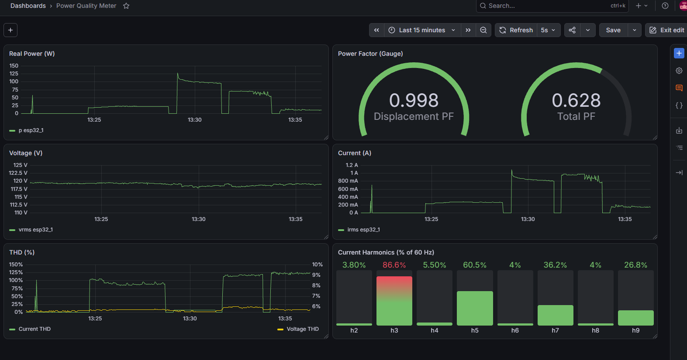
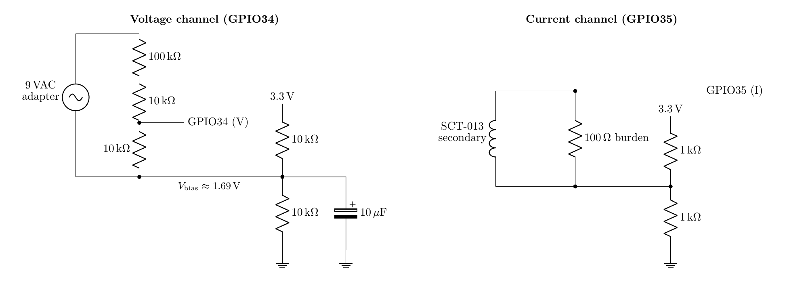
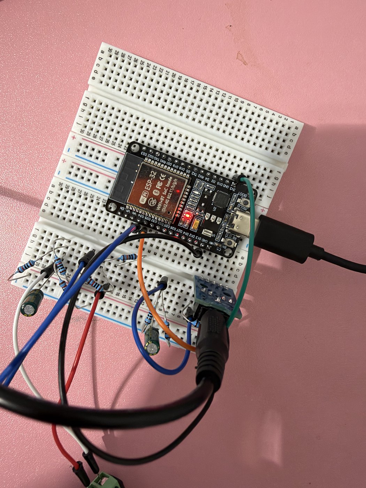
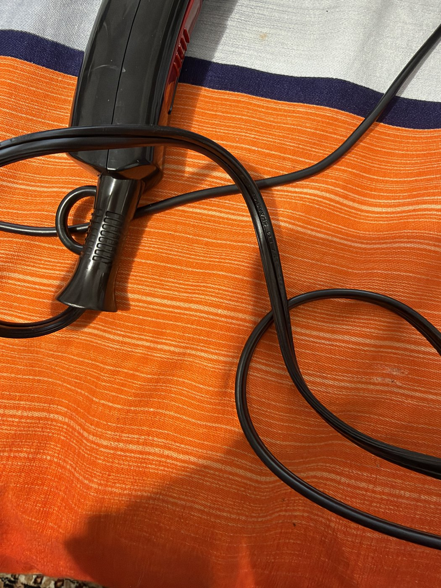
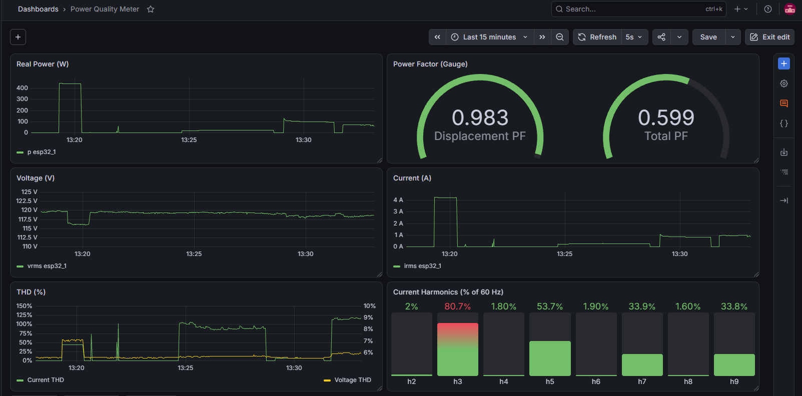
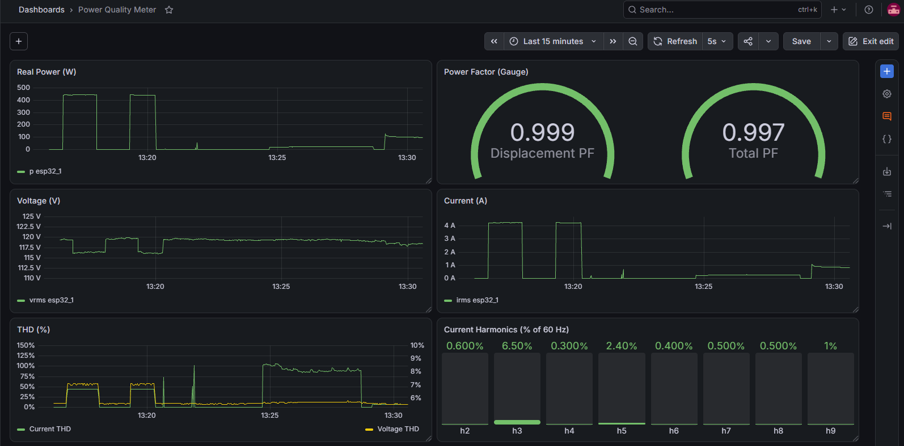

# ESP32 IoT Power Quality Meter

A low-cost single-phase AC power quality meter built on an ESP32. It measures **real and reactive power, power factor, and current/voltage harmonics up to the 15th**, and streams the results once per second over Wi-Fi to a live Grafana dashboard (ESP32 → MQTT → Python → InfluxDB → Grafana).

After calibration against a P3 Kill A Watt reference meter, **real power agreed within ±2.5% from 22 W to 452 W** on four very different loads.



📄 **Full technical report (17 pages):** [docs/pq_meter_report.pdf](docs/pq_meter_report.pdf)

---

## What it measures

| Quantity | Description |
|---|---|
| Vrms, Irms | RMS voltage and current |
| P, S | Real power (W) and apparent power (VA) |
| PF | Total power factor = P / S |
| DPF, P1, Q1 | Displacement PF, real and reactive power of the 60 Hz fundamental |
| THD-I, THD-V | Total harmonic distortion of current and voltage |
| H2 – H9 | Individual current harmonics as % of the fundamental |

## How it works

```
120 V outlet ──► 9 VAC adapter ──► divider + 1.69 V bias ──► ESP32 GPIO34
     │
   load ──► SCT-013-000 CT ──► 100 Ω burden + 1.65 V bias ──► ESP32 GPIO35
                                                                │ Wi-Fi (MQTT, JSON)
                                                                ▼
                         Grafana ◄── InfluxDB ◄── Python bridge ◄── Mosquitto
```

- **Safe by design:** no mains conductor touches the electronics. The adapter's transformer and the clip-on CT provide isolation.
- **Synchronous sampling:** 250 samples at 5 kHz = exactly 3 cycles of 60 Hz, so every harmonic lands in its own DFT bin with no leakage.
- **Real power** = average of v × i (correct for any waveform), with a 3.2° phase correction for the CT's phase lead.
- **Harmonics** by DFT up to the 15th (900 Hz); each result averages 15 cycles.
- **Noise-floor correction** and a no-load rule so small readings are not just noise.



| Breadboard build | CT on one conductor of a split zip cord |
|---|---|
|  |  |

## Accuracy

Tested against a Kill A Watt on Nov 12, 2026, one day after calibration and after re-clipping the CT.

| Load | Turns through CT | Reference (W) | Meter (W) | Error |
|---|---|---|---|---|
| Phone charger | 3 | 11.2 | 11.7 | +4.6% |
| LED lamp | 3 | 22.9 | 22.5 | −1.9% |
| Laptop charger | 3 | 70.4 | 69.9 | −0.7% |
| Fan | 3 | 100.0 | 102.5 | +2.5% |
| Hair dryer (LOW) | 1 | 452 | 443 | −1.9% |

On the calibration day (Nov 11), errors were within ±0.5% on the lamp, fan and hair dryer. The 11 W phone charger is at the bottom of the measurable range, where the CT signal is close to the noise floor.

## Harmonic results

| Load | THD-I | H3 | H5 | DPF | Total PF |
|---|---|---|---|---|---|
| Fan (motor) | ~7% | 6.5% | 2.4% | 0.999 | 0.997 |
| LED lamp | ~88% | 70% | 35% | 0.96 | 0.70 |
| Laptop charger | ~113% | 79% | 50% | 0.980 | 0.617 |
| Phone charger | ~122% | 86% | 58% | 0.996 | 0.63 |
| Hair dryer LOW | ~44% | H2 = 42% | — | 1.000 | 0.69* |

**Key findings**
- Chargers and LED drivers have a displacement PF near 1 but a total PF near 0.6: the low PF comes from **harmonic distortion, not phase shift**. Measured PF matched PF ≈ DPF / √(1 + THD²) on every load.
- The half-wave hair dryer showed H2 = 42%, matching Fourier theory (42.4%).
- *A CT cannot see DC current, so on the half-wave load it reads ~77% of the true current (measured 75.5%). Real power is still correct.

| Laptop charger | Fan |
|---|---|
|  |  |

## Repository layout

```
firmware/pq_meter/pq_meter.ino   ESP32 sketch (Arduino IDE)
bridge/mqtt_to_influx_meter.py   MQTT → InfluxDB bridge
bridge/requirements.txt          Python packages
broker/mosquitto.conf            Mosquitto broker settings
grafana/                         Dashboard export (JSON)
docs/pq_meter_report.pdf         Full technical report
docs/images/                     Screenshots, photos, wiring diagram
```

## Running it

1. **InfluxDB 2.x:** create org `vpp`, bucket `power_meter`, and an API token. Save the token in `bridge/meter_token.txt` (this file is git-ignored).
2. **Mosquitto:** `mosquitto -c broker/mosquitto.conf -v`
3. **Bridge:** `pip install -r bridge/requirements.txt`, then `python bridge/mqtt_to_influx_meter.py`
4. **ESP32:** in `pq_meter.ino`, set your 2.4 GHz Wi-Fi name and password and the IP of the computer running Mosquitto. Install the **PubSubClient** library, select **ESP32 Dev Module**, and upload.
5. **Grafana:** add an InfluxDB (Flux) data source and import the dashboard from `grafana/`.

## Bill of materials (~$128 including the reference meter)

ESP32 DevKit (ESP-WROOM-32) · SCT-013-000 CT (100 A : 50 mA) · 9 VAC 500 mA adapter · resistors (100 k, 3× 10 k, 2× 1 k, 100 Ω) · 10 µF capacitor · 3.5 mm breakout · barrel jack · breadboards · 16/2 flat extension cord · P3 Kill A Watt (reference)

## Lessons learned

- Check DC bias points with a meter before connecting signals (a floating bias node read 1.13 V instead of 1.69 V).
- A CT can't see DC, and DC current can **saturate** its core: the half-wave load read 14% low with 3 turns, 1.3% with 1 turn.
- Small loads need multiple turns through the CT; one turn read an LED lamp 17% low.
- A split-core CT that isn't fully closed reads low (−20%) and inflates THD.
- Phase calibration doesn't change RMS readings but matters a lot for real power.

## Safety

This project involves mains voltage. The electronics are isolated, but the split cord and CT are at 120 V. Keep the conductors' own insulation intact, stay within the cord's rating, and do not attempt this without understanding the risks.

## License

MIT, see [LICENSE](LICENSE).

---
Mahedi Hasan · Electrical Engineering, The City College of New York · 2026
